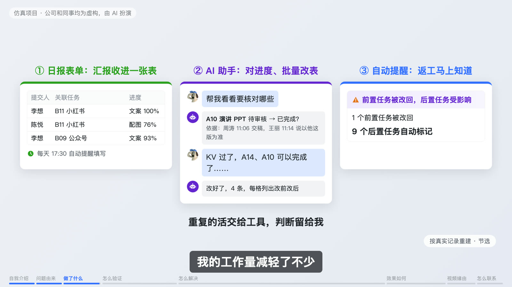
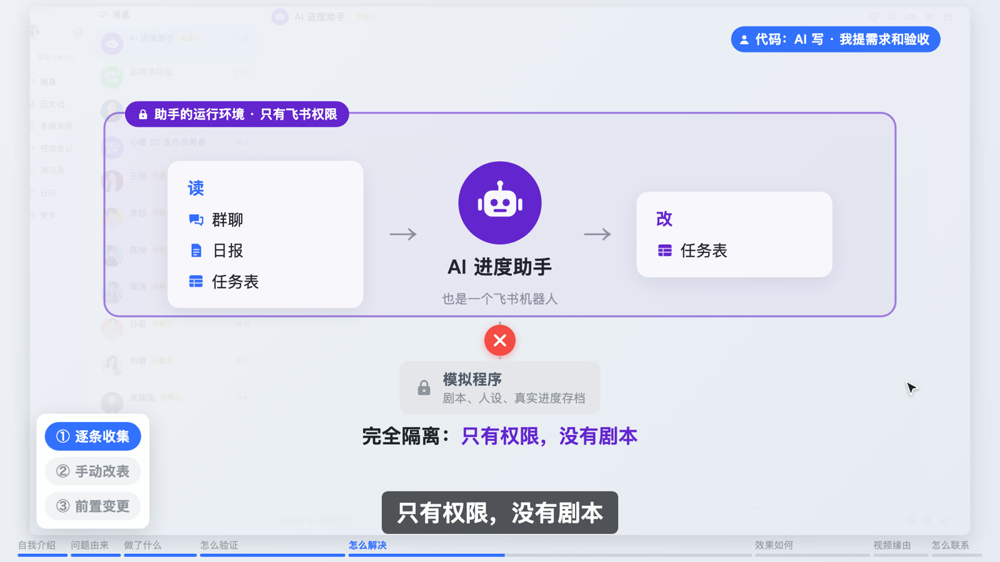
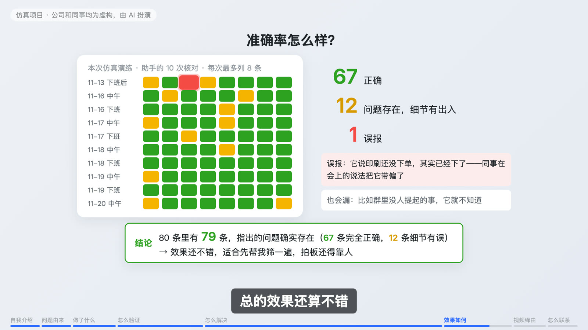
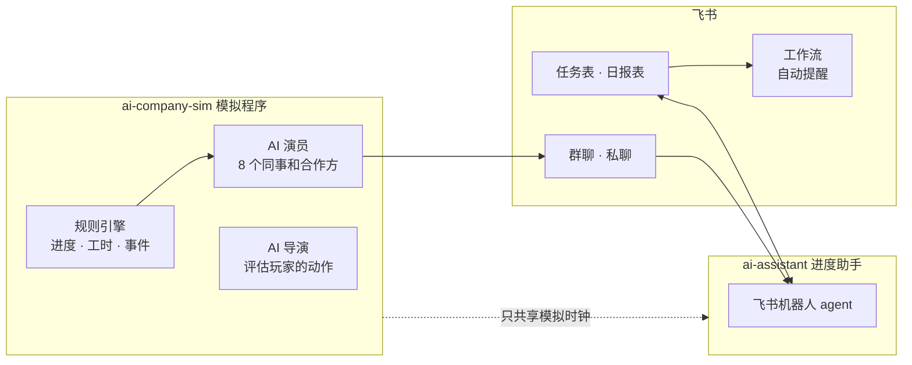

<div align="center">

# 飞书 × AI 小团队管理演练

**用 AI 模拟一个市场部，在飞书里搭工具把团队管顺，再逐条验证工具到底有没有用**


</div>

> 本项目为个人搭建的仿真演练：公司、人物、数据均为虚构，由 AI 扮演；流程设计、自动化配置和管理决策由我完成。

## 这是什么

工作里，进度信息散在群聊、私聊、简报和表格里，又多又杂。能不能先让 AI 把它们聚到一起、找出要核对的地方，再由人来判断？

为了回答这个问题，我做了两件事：

1. **搭一个结果能核对的模拟团队**：一家小家电公司的市场部，同事和合作方一共 8 个人，全部由 AI 扮演，每个人都是一个飞书机器人。团队同时推进发布会、内容更新、入职流程优化三个项目，我作为项目助理跟进进度，演练了 15 个工作日。
2. **在飞书上做一套提效工具**：一张日报表单、一个 AI 进度助手、一条自动提醒流程。

模拟团队里，**说什么由 AI 来演，活干到哪一步由程序按工时算**。所以同事会说错、会拖，但不会凭空变出进度。每一步都有记录，工具有没有用，可以逐条验证。

## 三个工具



| 工具 | 解决什么 | 怎么做的 |
|---|---|---|
| ① 日报表单 | 汇报散在群聊私聊，到处翻 | 飞书多维表格表单，每天 17:30 自动提醒填写，汇报收进一张表 |
| ② AI 进度助手 | 自己对进度、一格一格改表 | 飞书机器人 agent：读群聊、日报和任务表，列出要核对的地方并附原话；我确认后批量改表，可撤销；它自己推断的改动先问我 |
| ③ 自动提醒 | 前置任务返工，后面的人最后才知道 | 飞书工作流：已完成的任务被改回「进行中」，依赖它的任务自动标成「受影响，待确认」，马上提醒我 |

## 只有权限，没有剧本



AI 进度助手是一个**独立项目**，和模拟程序完全隔离：

- 它只能通过飞书 API 读群聊、日报和任务表，只能改任务表的 6 列，改动都有记录、可撤销。
- 它看不到模拟程序的代码、剧本、人设和真实进度存档，代码里也不 import 模拟程序的任何东西（有测试检查）。
- 两边唯一的连接是模拟时钟（现在是第几天几点），相当于真实公司里电脑的系统时钟。

## 准确率



演练中助手一共核对了 10 次，发出 80 条提醒。助手看不到存档，我让另一个 AI 拿存档里的真实进度逐条去对，有出入的再由我逐条复核：

| 结果 | 条数 |
|---|---|
| 正确 | **67** |
| 问题存在，细节有出入 | **12** |
| 误报 | **1** |

另外也有漏报，一部分是因为群里根本没人提起。结论：适合先帮人筛一遍，拍板还得靠人。

> 分工原则：规则明确的，交给自动流程；需要理解和核对的，让 AI 找出依据；要确认、会改动结果的，由人拍板。

## 项目结构



| 目录 | 是什么 |
|---|---|
| [`ai-company-sim/`](ai-company-sim/README.md) | 模拟程序：8 个 AI 角色、3 个并行项目、15 个工作日。进度由规则计算，AI 只负责说话和评判 |
| [`ai-assistant/`](ai-assistant/README.md) | AI 进度助手：飞书机器人 agent，和模拟程序完全隔离，只通过飞书 API 读写 |
| `shared/` | 两者之间唯一的连接：模拟时钟 `clock.jsonl`（运行时生成） |
| [`video/`](video/README.md) | 求职视频（Remotion），画面全部用代码绘制，内容来自真实聊天和表格记录 |
| `AI模拟公司设定包.md` | 完整设定（**含剧透**，想自己玩的话先别看） |

## 自己跑一遍

需要：一个飞书账号（建议新建一个团队，别用真实工作空间）、一个 OpenAI 兼容的大模型 API Key（默认 DeepSeek）、[uv](https://docs.astral.sh/uv/)。

```bash
cd ai-company-sim
uv sync --extra feishu
cp .env.example .env          # 填 LLM_API_KEY
LLM_MODE=offline uv run sim init --force   # 离线试跑，不调用大模型
```

完整步骤（建飞书机器人、配多维表格、开局）见 [`ai-company-sim/README.md`](ai-company-sim/README.md)，助手的配置见 [`ai-assistant/README.md`](ai-assistant/README.md)。

> ⚠️ **防剧透**：想当玩家的话，只读 `README.md`、`ai-company-sim/docs/玩家手册.md` 和 `ai-company-sim/docs/飞书配置指南.md`。

## 关于代码

代码由 AI 编写，我负责提需求、定规则和验收。这个项目想展示的是：把重复的流程找出来、拆成需求，再借助飞书和 AI，搭出表单、工作流和助手，最后对照记录，检验到底有没有用。
